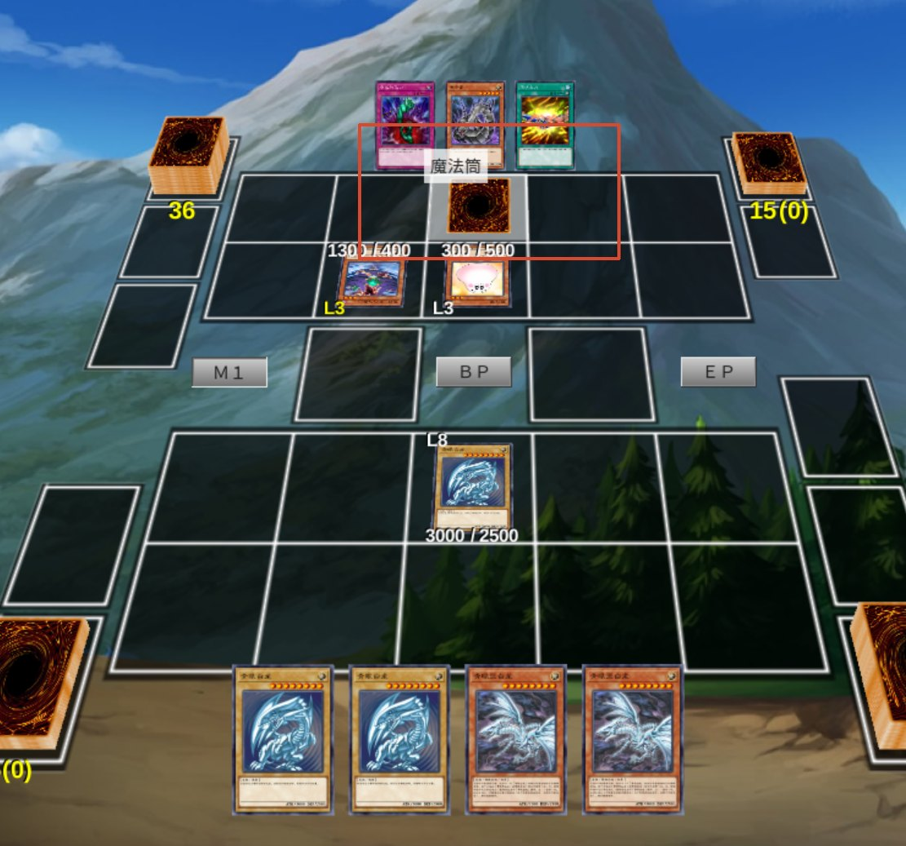

# 使用游戏测试该局

> 入口：菜单 `ygo` → `使用游戏测试该局`（快捷键 `Ctrl + T`）
> 配置：`偏好设置` → `对局测试`
> 相关：顶栏「启动规则校验」与客户端内核的区别见[引擎模式与规则校验](引擎模式与规则校验.md)

把当前编排好的**局面**导出成客户端能读的残局脚本，并启动游戏，用来在真实客户端里确认卡面、位置、连锁和规则表现。MDPro3 和 ygopro 会直接进局；EDOPro 只会启动游戏，需要自己从残局模式里选脚本。

> 注意：它只导出**当前这一手**的场面（双方手牌、场上卡、额外卡组、LP、先后手），不导出之前的操作过程。想把整段编排“演”出来，用 `ygo` → `导出对局回放`。

## 导出到哪里

| 客户端     | 脚本位置                                            | 进游戏的方式                                                                |
| ---------- | --------------------------------------------------- | --------------------------------------------------------------------------- |
| MDPro3     | `<游戏目录>/Puzzle/yde-test/<工程标题>.lua`         | 自动：`MDPro3.exe -s yde-test/<工程标题>`，直接进残局                       |
| ygopro     | `%APPDATA%/ygo-duel-editor/ygo-test/<工程标题>.lua` | 自动：`ygopro.exe -s <脚本完整路径>`，直接进残局                            |
| EDOPro-KCG | `<游戏目录>/puzzles/yde-test/<工程标题>.lua`        | 手动：只会启动游戏，需自己进「残局模式」→ `[yde-test]` → 选脚本（原因见下） |

每次导出都会先清空 `yde-test` 目录再写入，同名直接覆盖。使用前需要先在 `偏好设置 → 路径` 里选好游戏目录（会自动识别 `ygopro` 还是 `mdpro3`）。

### 为什么 EDOPro 要多一步

EDOPro（`Edopro-KCG.exe`）从 39.3.0 起删掉了几乎所有命令行参数——`-s`（加载残局）、`-r`（加载回放）都没了，只留 `-C` / `-m` / `-l` 这类。所以本工具没法像 MDPro3 / ygopro 那样“一条命令直接进局”，只能把脚本写进 `puzzles\yde-test\`，然后由你自己点进去：

1. 启动游戏 → 主菜单进「残局模式」；
2. 左侧列表里选 `[yde-test]`，点「打开文件」进目录；
3. 选你的脚本（名字 = 工程标题）打开，就进局了。

![EDOPro：在残局模式里手动选 [yde-test] 目录](../images/edopro-puzzle-entry.jpg)

## 进游戏之后怎么打

- **单人残局**：没有强制的人机对手，双方都由你一个人操作（上帝视角），双方手牌和盖牌都能看到。
- **谁能动**：只有**当前回合方**的牌可以操作。轮到你时只能动你的牌；要替对方打，先把回合交出去（结束回合），等对方回合开始再操作对方的卡。
- **首回合规则**：脚本会按工程类型带规则——「整局」是多回合正常决斗（首回合玩家跳过抽卡，之后每回合抽 1）；「残局 / Combo」走残局规则（结束阶段判负，等于给回合数设了上限）。
- **牌序**：由 `偏好设置 → 对局测试 → 牌序` 决定。`固定牌序` 时手牌和卡组完全按编排落位；`随机洗牌` 时编排的手牌会并回卡组重新洗切，开局抽 5 张。

## 当前已知问题：MDPro3 选位置错位

> 状态：已提 issue，等待修复 —— <https://code.moenext.com/sherry_chaos/MDPro3/-/issues/172>

### 现象

在 MDPro3 里，轮到对方（上半场）并让它做**需要选位置**的动作时——盖放魔陷、上级召唤、从额外卡组特殊召唤、把卡放到场上——提示写的是「请为对方的「X」选择位置」，但高亮、可点的是**你自己（下半场）**的格子：

点下去卡落在**你的场地**；点对方那一排没有反应，有时直接弹「游戏出错」，提示还会串成「请选择要变成不能使用的卡片区域」：

### 原因

客户端把 `MSG_SELECT_PLACE` 里的 `player` 丢掉了（`GameMessage_SelectPlace` 里读出来又注释掉），而高亮逻辑 `HighlightThisZone` 是拿格子的 `controller` 去挑掩码的一半。内核的这块掩码是**以应答者为本位**的（低 16 位对应“正在选位置的那一方”的场地），应答者一丢，就永远按 0 号位那半去解释——对方的请求被画到了你的半场。

### 影响

- 对方所有需要选位置的动作都会错位，落点跑到你这边；
- 少数情况会触发「游戏出错，请重试。或者保存回放并联系开发者」。

### 为什么 ygopro 没这个问题

ygopro 的客户端读了 `player`，按应答者映射掩码，所以对方选位置时亮的是对方的格子，能正常落位：

### 现在的规避办法

1. 双人同步测试改用 **ygopro / EDOPro**（本项目都支持），MDPro3 只用来播放回放；
2. 需要对方站位的局面，先在编排里把卡摆好（`剧情安排`），再进 MDPro3 验收，不要在客户端里临时给对方下卡；
3. 关注 issue 进展，修好后这条限制就不存在了。

## 另一个 MDPro3 问题：历史面板的 LP 显示 0

### 现象

角标上的 LP 正常（8000），但右侧历史里每个回合头像下面都是 `LP 0`；中途掉血后，历史里的数值也不对。实际对局、胜负判定、卡的效果都不受影响，只是侧边记录显示错。

### 原因

两套 LP 各记各的：

- 角标用的是 `DuelMessage` 的 `life0/life1`，它在 `GameMessage_ReloadField` 里从 `RELOAD_FIELD` 消息中读 LP，所以正常；
- 历史面板用的是 `LogMessage` 自己的 `life0/life1`，只在 `GameMessage_Start` 里赋值，而 `GameMessage_ReloadField` 只读了 `MasterRule`，**完全没读 LP**。残局是直接靠 `Debug.ReloadFieldBegin/End` 起局的，历史面板从一开始就是 0，之后掉血也是从 0 开始加减。

### 属于谁的问题

MDPro3 客户端的问题，和导出的脚本无关——脚本已经把双方的 LP 通过 `Debug.SetPlayerInfo` 写进了 `RELOAD_FIELD` 消息，否则角标也不会显示 8000。修复点是让 `LogMessage.GameMessage_ReloadField` 像 `DuelMessage` 那样把两个 LP 读出来（注意要按消息里的玩家顺序读，并在中间跳过前一个玩家的卡表），或者干脆在 `GameMessage_NewTurn` 时直接取对局当前的 LP。

可以在 MDPro3 仓库单独提一条 issue，附上任意残局的截图即可复现。

### 脚本侧试过、绕不过去

试过在 `Debug.ReloadFieldEnd()` 之后用 `pcall` 调 `Duel.SetLP(0/1, 当前 LP)`，想借一次 `MSG_LPUPDATE` 把历史面板的计数器刷正——实测无效，历史仍然显示 0（启动阶段要么不允许这个调用，要么内核认为数值没变就不发消息）。唯一能稳定产生 LPUPDATE 的办法是制造一次真实 LP 变化，但那样历史里会多出“基本分改变”的记录，比显示 0 更难看，所以本工具不做这种补丁。

结论：这条只能等客户端修。
