# 01安装和基本界面

## 安装

### 无法识别的应用启动

之所以有这个，是因为这个项目没有 Authenticode 签名

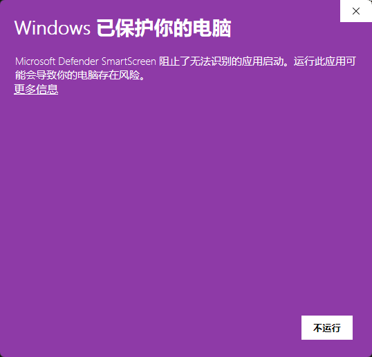

直接「更多信息」->「仍要运行」就可以继续安装了

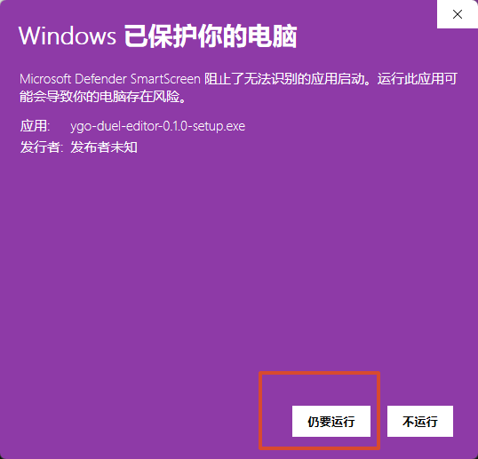

### 选择程序安装目录

选择合适的目录安装

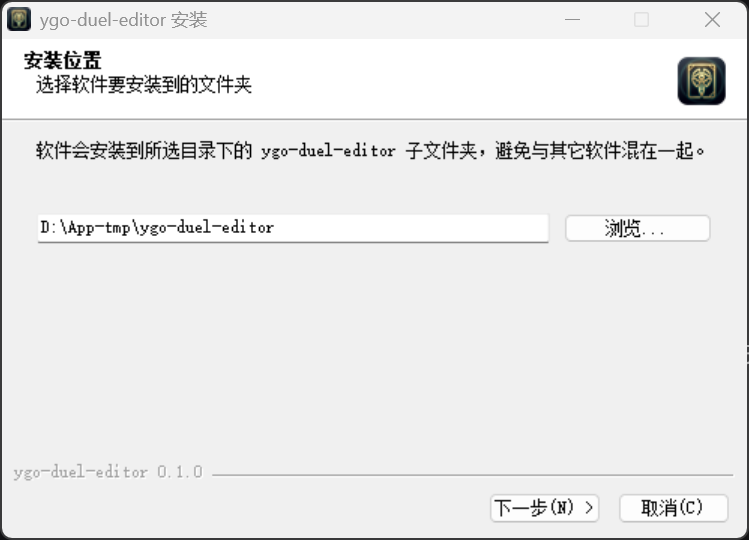

### 选择数据保存目录

选择合适的目录安装

**注意：**

卸载和更新都不会删除，但**不要把数据目录选到软件安装目录内，不然软件更新时会被清空**

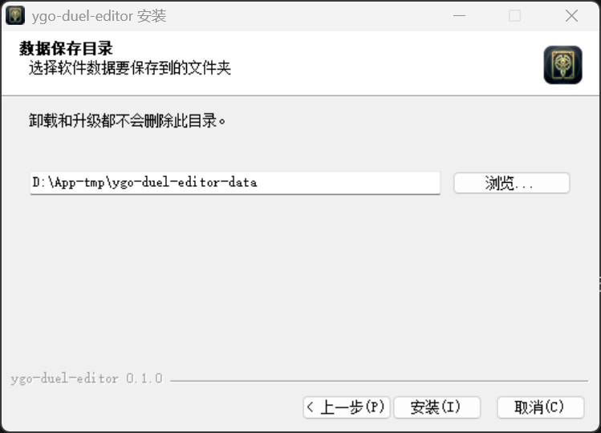

**默认文件夹**

| 目录            | 用途                                                                                                             |
| --------------- | ---------------------------------------------------------------------------------------------------------------- |
| `projects\`     | **工程库**：每个工程对应一个 `.ygoduel`，含盘面、步骤、台本文本和引擎快照                                        |
| `texts\`        | 导入的**文本素材**：原文（txt、md）和章节切分信息（`.chapters.json`）                                            |
| `text-library\` | **文本库**：markdown 文件树，台本可以「导出到文本库」                                                            |
| `custom\`       | **自定义卡片**相关：`yde-custom.cdb`（生成的卡库）、`pics\`（卡图）、`script\`（Lua 脚本），后两个要用到才会出现 |

**根目录 JSON**（用到才生成）

| 文件                         | 用途                 |
| ---------------------------- | -------------------- |
| `ygo_duel_editor_decks.json` | 卡组库（卡组和分组） |
| `card_notes.json`            | 卡牌图鉴的笔记       |
| `custom_cards.json`          | 自定义卡片数据       |
| `custom_setcodes.json`       | 自定义字段、系列名称 |

## 启动界面

首次启动会弹出一个欢迎窗口，提示**用户未设置默认 ygo 路径，请设置**

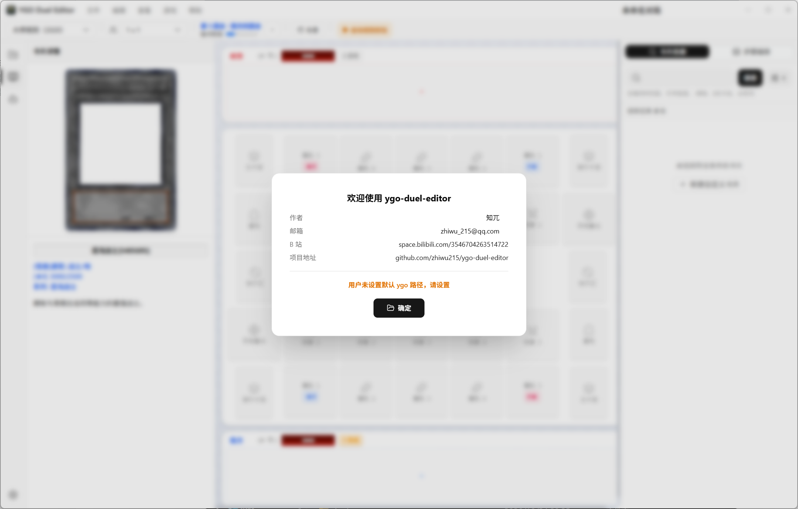

文件选择框里选中**客户端根目录**，也就是包含 `ygopro.exe`，即客户端exe的那一层

> 我使用ygopro、mdpro3、edopro-kcg测试过，所以理论上，ygopro、ygopr2、mdpro3、edopro、edopro-kcg等都不会有太大问题

选好后软件会自动识别客户端类型，并读取卡库、卡图、脚本、禁限等

**这边建议使用ygopro客户端**

> 你选择的客户端会影响卡组数据库的搜索、游戏脚本的启动等等

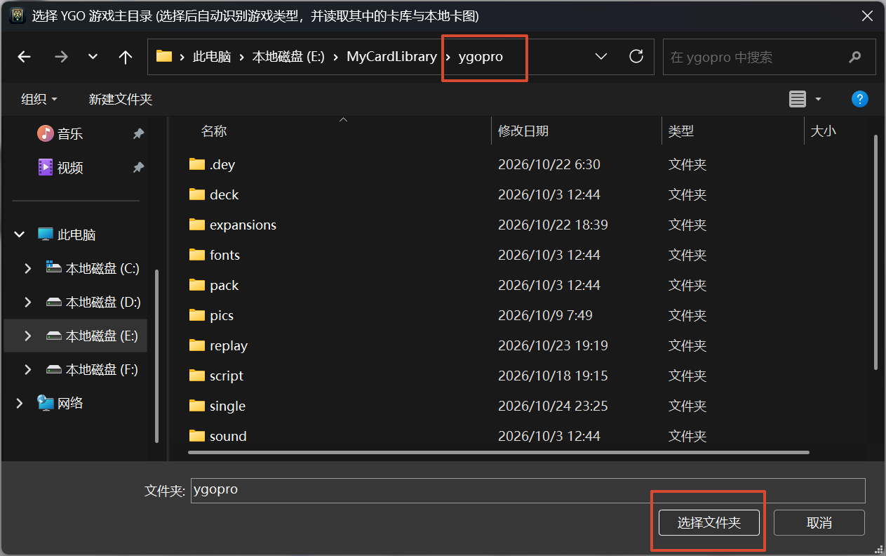

可以在设置界面查看

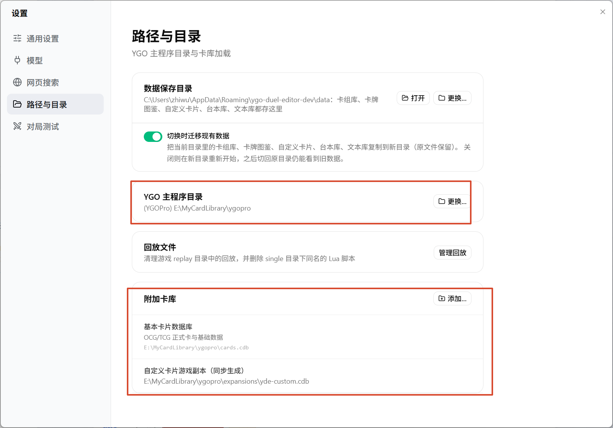

### 使用MDPro3

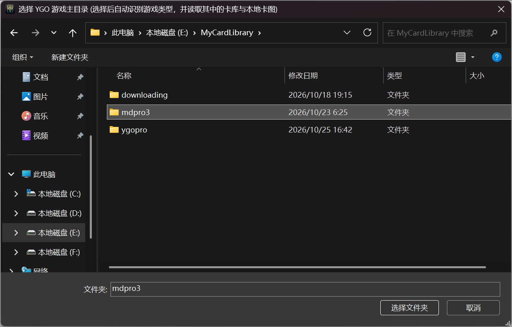

MDPro3 自带的 `Picture/Art` 通常只有卡牌插画，没有卡框和文字。软件检测到这种情况时会问：

- “选择卡图目录”：指定一个 YGOPro 的 `pics` 文件夹，或包含 `pics` 的游戏目录
- “继续使用插画”：先只用插画，之后可以在设置里补选

这一步只影响卡图显示，不影响卡片数据和规则。

如果选择继续使用插画，也就是使用MDPro3自带的卡图

效果如图：

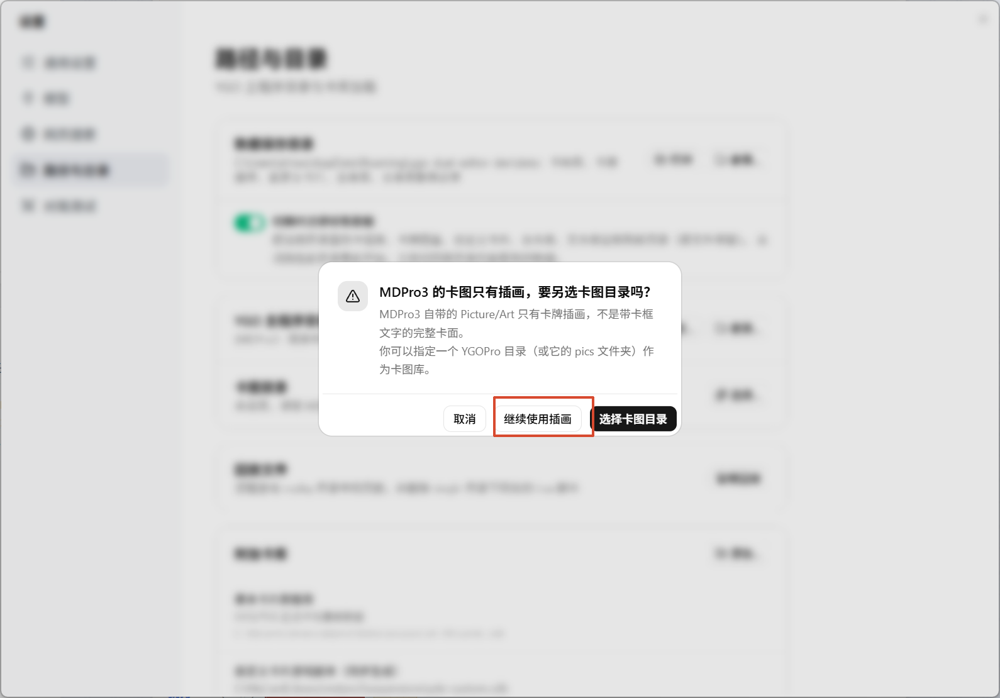

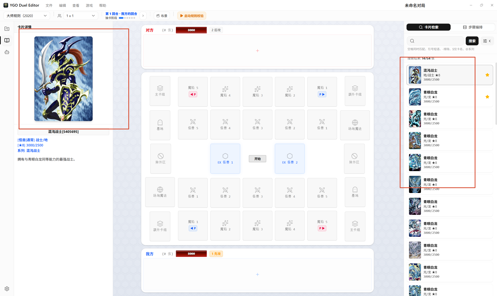

对于MDPro3，有专门的选项可以设置卡图

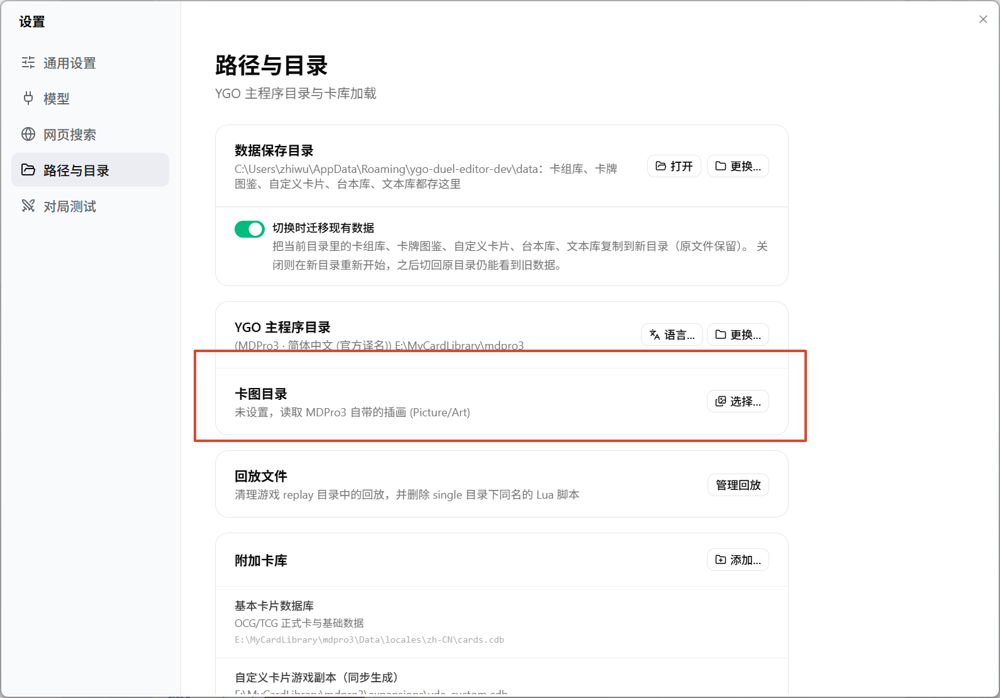

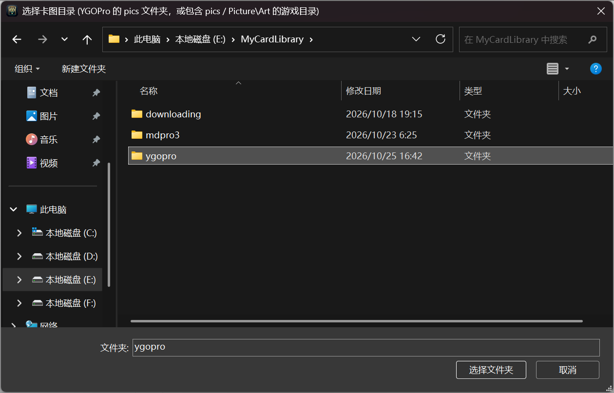

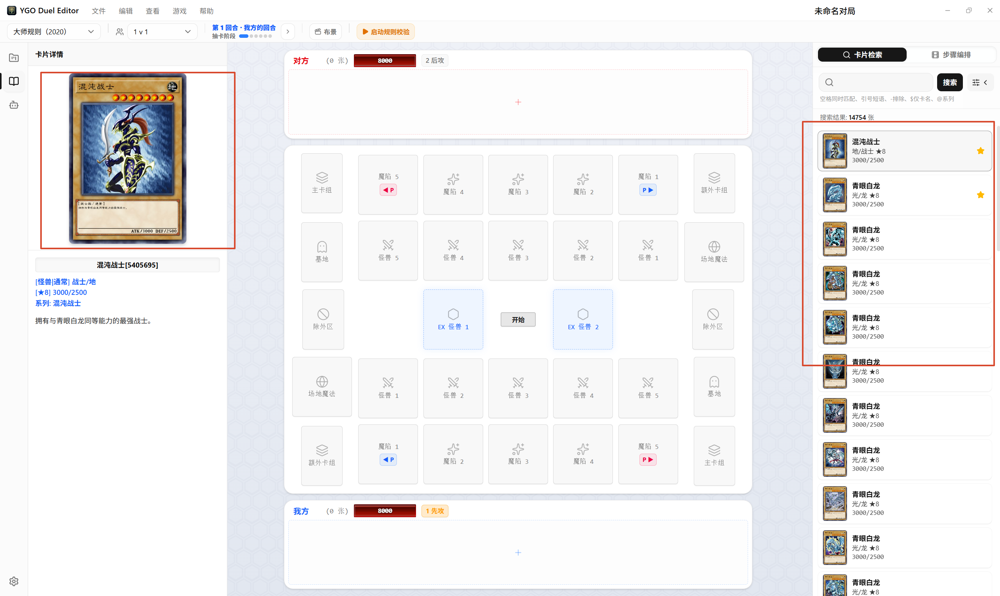

### 使用EDOPro-KCG

可以看到，所有的卡库都会加载进来

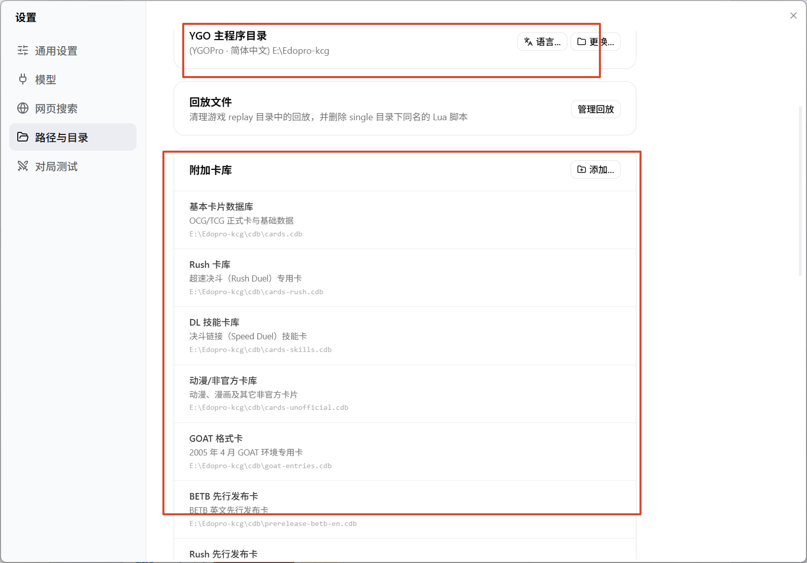

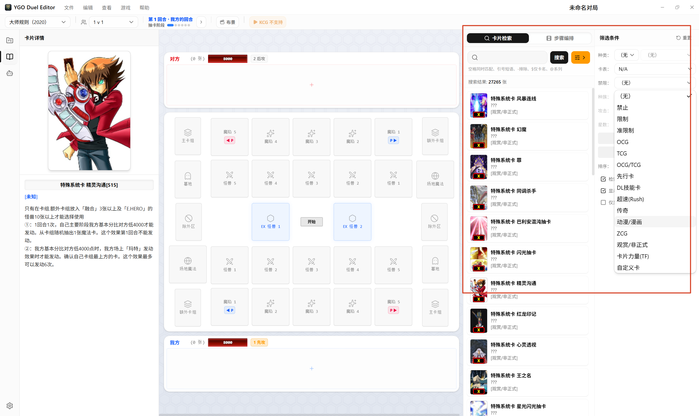

## 基本界面

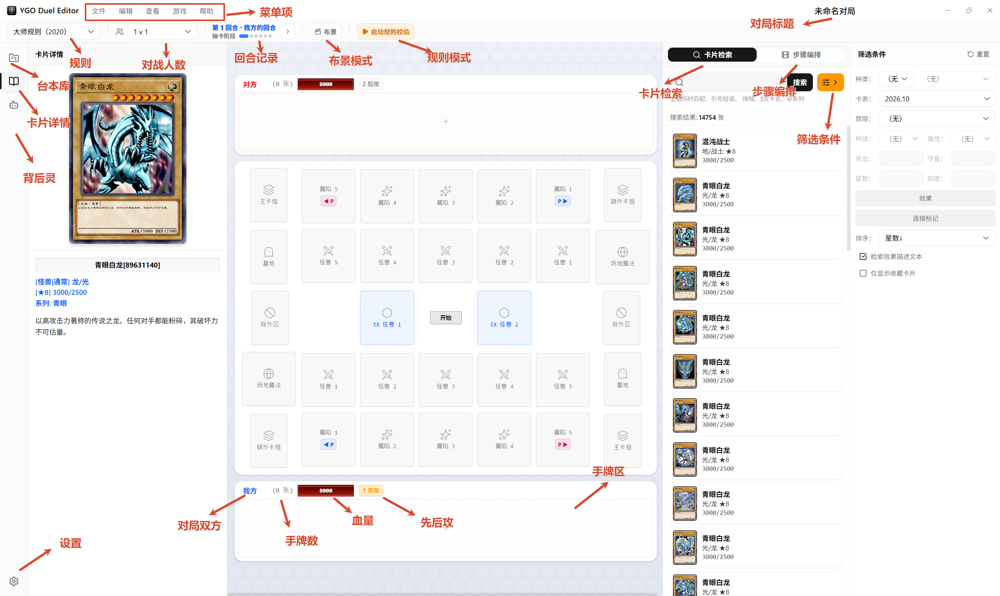

详细请看：

> 文档中不会把每一个按钮都讲解
>
> 但大部分都会详细讲述，尽量把一个工作流讲述清楚

## 卸载

像正常应用一样卸载就可以了

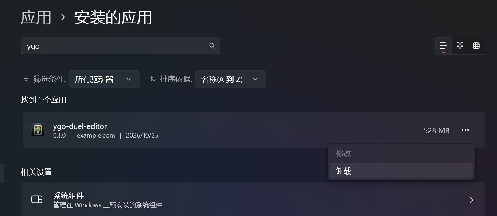

不过数据仍会保留，所以需要手动删除了

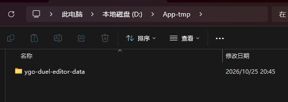
