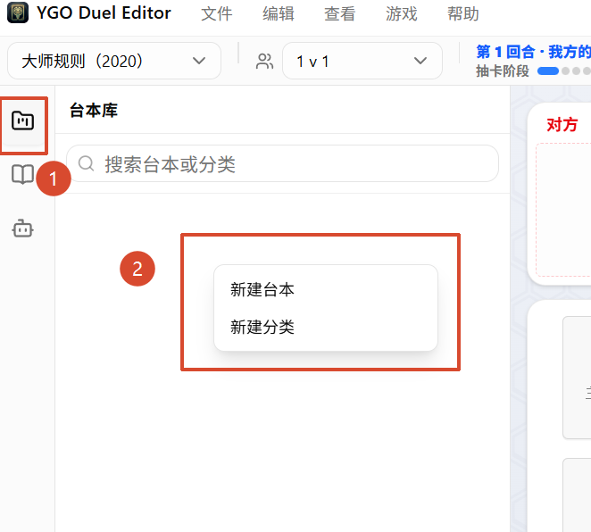
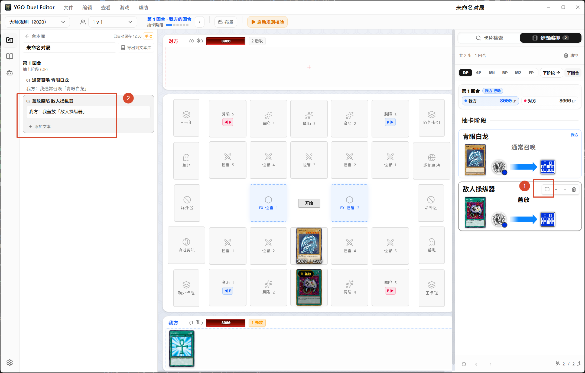
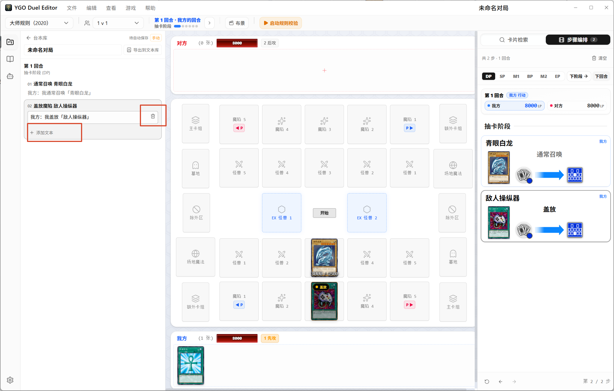
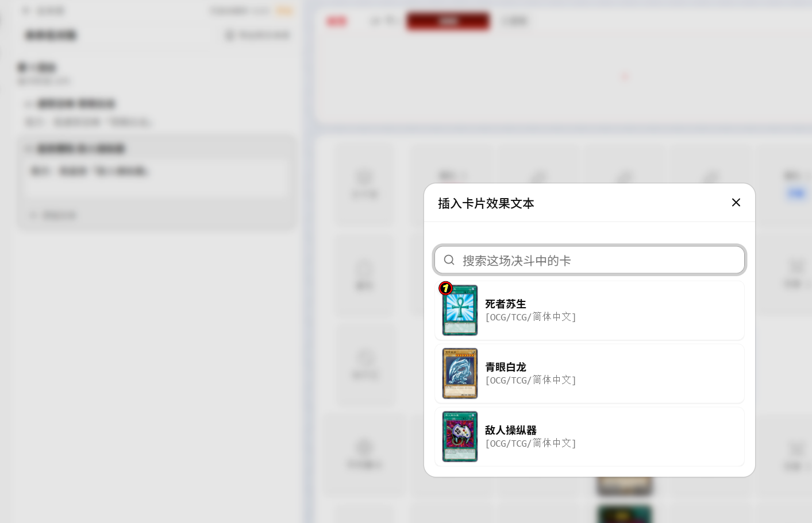
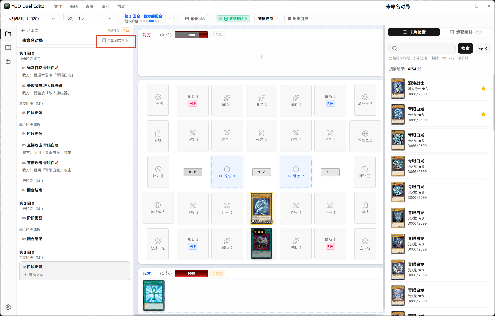
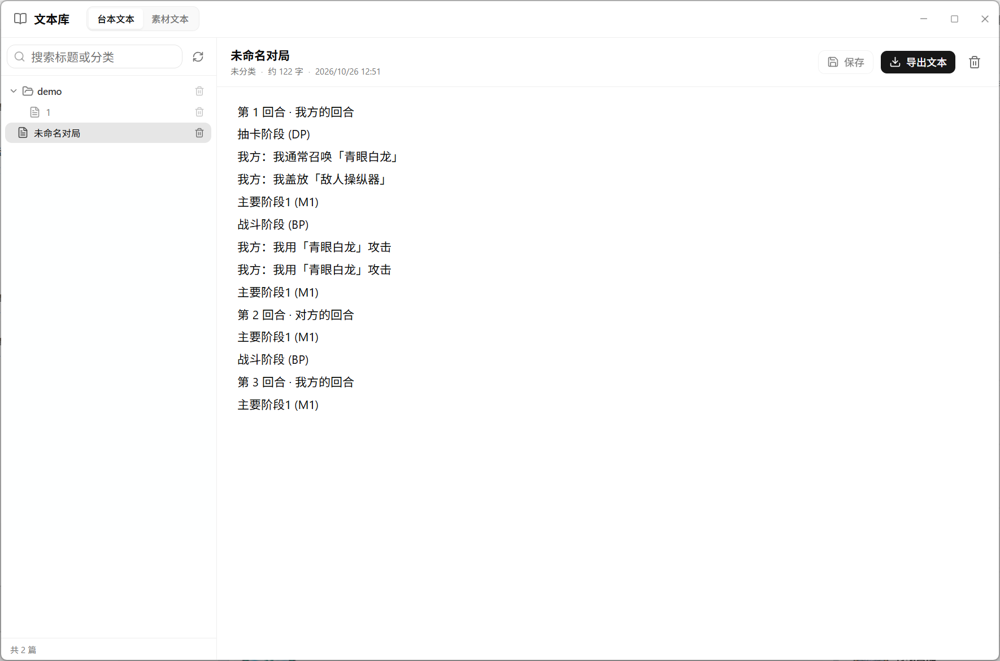
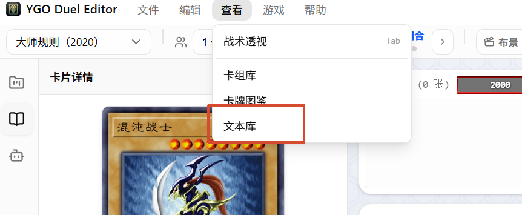
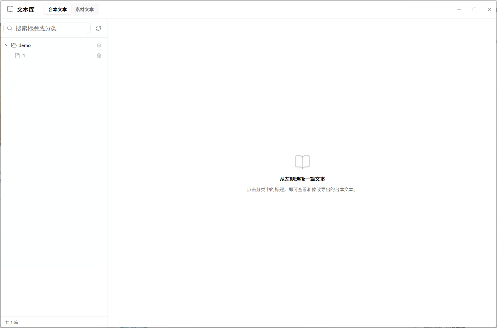
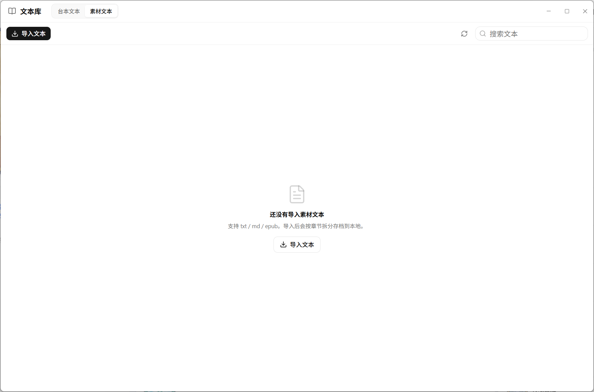

# 04台本文本与文本库

## 打开台本文本编辑器

左侧栏“台本库”

步骤卡悬停 → 书本图标：打开台本编辑器并定位到该步。

## 自动文本与手动文本

### 自动文本

对于有卡名和动作类型的步骤，软件会自动生成一句台词，例如：

- 我方：我通常召唤【青眼白龙】
- 我方：我用「青眼白龙」攻击
- 引擎步骤还会根据日志生成召唤、发动、送墓、抽卡、伤害等行为

自动文本会跟随设置里的“卡名包裹符号”变化（默认是 `「」`），可以在设置中调整：

### 手动文本

自动文本也可以直接改。你一开始输入，这个文本块就会从“自动”变成手动，不再随步骤字段变化。

每个步骤可以有多段文本：

- 点“添加文本”增加一个空文本块
- 在文本块里输入台词/旁白
- 点文本块右上角垃圾桶删除
- 多个文本块会按顺序导出

### @语法插入卡片效果文本

在文本块里输入 `@`：

1. 弹出“插入卡片效果文本”窗口
2. 搜索本场决斗中出现过的卡（盘面上的卡、步骤里的卡）
3. 点一张卡，显示它的效果文本分段
4. 点某一段可以直接插入；也可以勾选多段后点“插入选中”
5. 插入的内容会替换当前光标位置的 `@`

## 导出到文本库

台本编辑器点“导出到文本库”

文本库按台本所在的分类路径创建文件夹，文件名使用台本标题。

如果同名文件已存在：

- 内容与上次导出完全一致：不重复写
- 文件从未被手动改过：覆盖
- 文件被手动改过：**不覆盖**，自动创建 `标题_2.txt` 这样的新文件，并提示“已另存为新文本”

导出的是纯文本，不含卡图、步骤字段、引擎日志。适合作为同人小说底稿等

## 文本库窗口

入口：菜单“查看 → 文本库”

窗口顶部有两个页签：

- **台本文本**：从台本导出的文本
- **素材文本**：导入的小说/设定资料

两个页签都留在同一个窗口里，切换不会丢失当前编辑

### 素材文本

用于存放小说、设定、剧本原文

> 我原本是打算能够拆分小说，然后让AI提取对局的
>
> 但实际上，这个实现很难，这个界面就是遗留下的

导入：

1. 点“导入文本”。
2. 选择 `.txt`、`.md`、`.epub`
3. 文件会复制到数据目录 `texts`，并自动按章节标题拆分
4. 成功后出现在列表里

支持的文件：

- `.txt`：最稳。
- `.md`：按纯文本处理，Markdown 标记会保留。
- `.epub`：软件会尝试从 HTML 中抽纯文本。部分 EPUB 是压缩/字体加密格式，抽不出来；遇到导入失败，先用 Calibre 等工具转成 `.txt` 再导入

**自动拆分规则**

软件会把下面这些行当作章节标题：

- `第一章`、`第二回`、`第三节`、`第一卷`、`第 12 章 标题`
- `Chapter 1`、`CHAPTER 12`
- `序章`、`楔子`、`引子`、`前言`、`后记`、`尾声`、`终章`、`番外`
- `1. 标题`、`1、标题`
- `【标题】`

如果全文少于 2 个标题行，或者标题行超过总行数的一半，就不会拆分，整篇作为一章
