# 05卡片图鉴与自定义卡片

## 打开卡牌图鉴

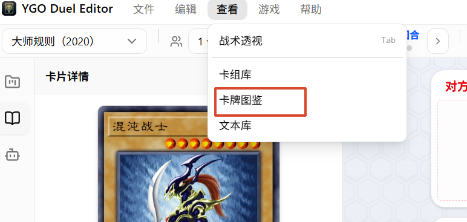

## 给现有卡录入图鉴

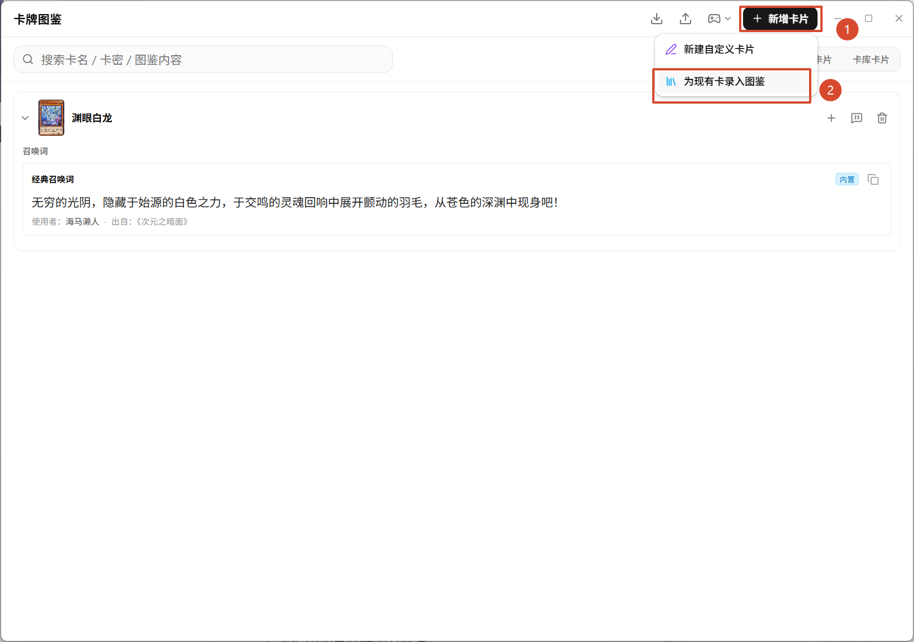

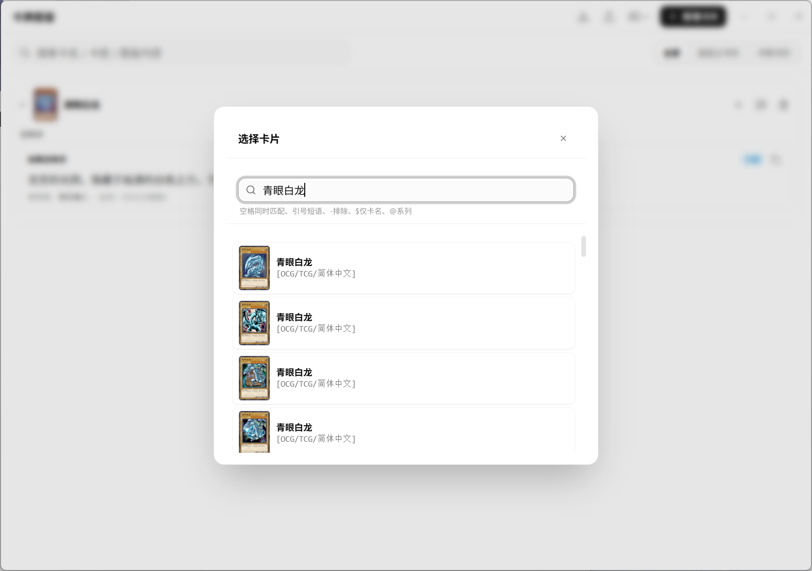

召唤词与备注

### 召唤词

用于记录角色召唤这张卡时的台词。可以有多条

- 原创：自己写的
- 借鉴：来自动画/漫画/其他作品，填来源后会在条目上显示“借鉴：来源”
- 条目可以拖拽排序
- 可以复制正文
- 可以编辑/删除

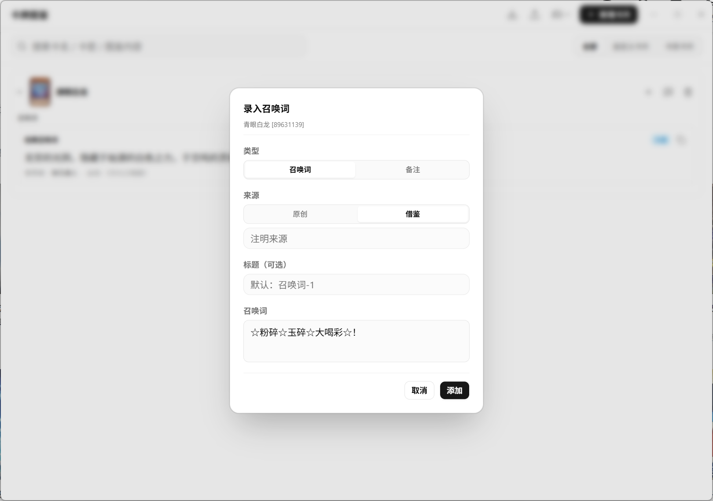

### 备注

用于记录卡牌考据、剧情等。可以有多条

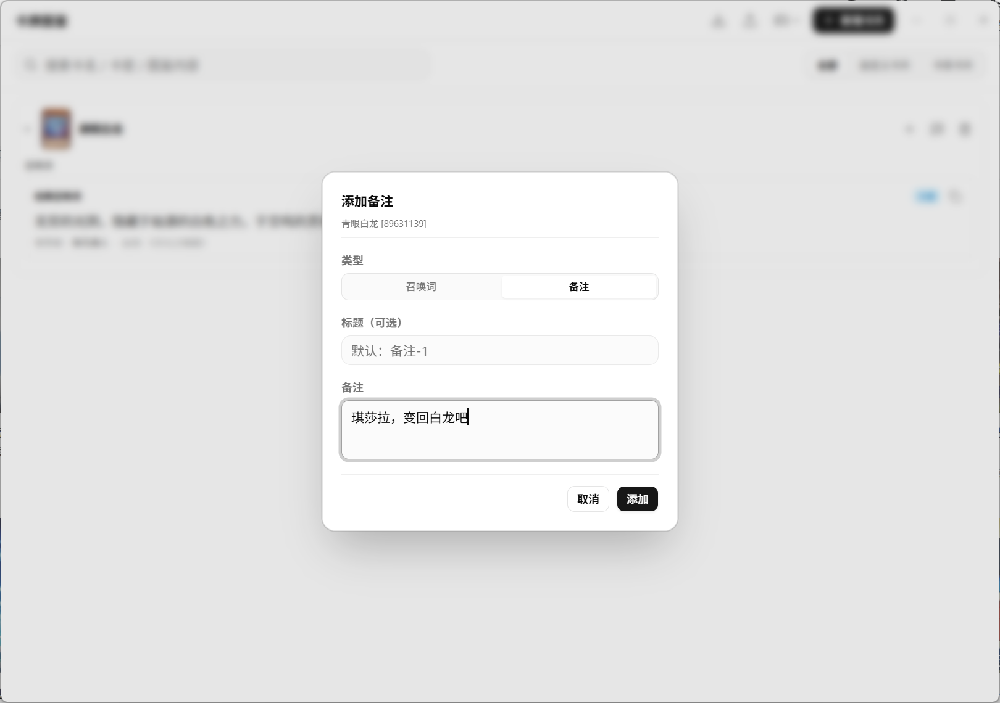

### 内置条目

软件自带一些经典召唤词，会标“内置”，并且：

- 不能编辑
- 不能删除
- 可以复制
- 内置条目不可拖动

“清空该卡”只会删除你自录的内容，内置条目保留

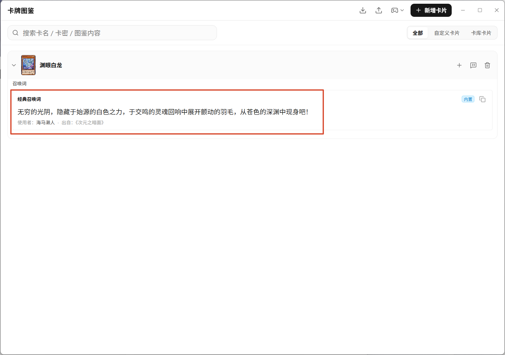

### 标题冲突

同一张卡、同一类型下，标题不能重复。新建时如果标题已存在，会提示换一个

### 排序

展开卡片后，召唤词和备注分别拖拽排序。松手即保存。

## 自定义卡编辑器

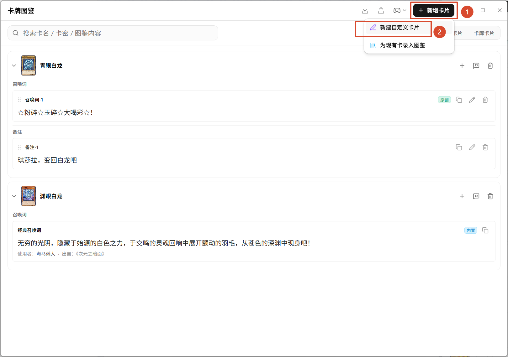

### 编辑器布局

在这里可以自定义卡片

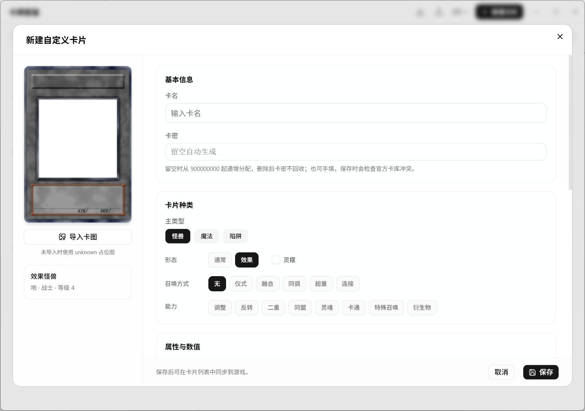

### 效果脚本

- 脚本由外部编写，本编辑器只关联，不内置代码编辑。
- 点“导入 Lua”选择 `.lua`。
- 保存后脚本按 `c<卡密>.lua` 存放。
- 可以替换、移除，或打开脚本目录。
- 脚本文件名建议就是 `c<卡密>.lua`；如果源文件名与卡密不一致，会提示并自动改名。
- 如果脚本里写死了别的卡密，会给出警告。

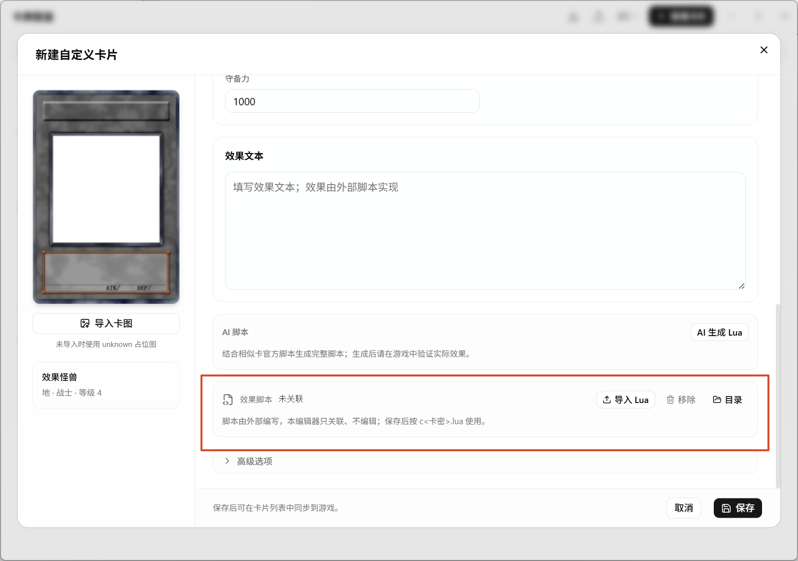

### AI 脚本

需要先在设置里配好模型

1. 点“AI 生成 Lua”
2. 软件会结合卡名、类型、效果文本，找相似卡的官方脚本作为参考，生成完整 Lua
3. 点“应用脚本”：新卡会自动保存，脚本按 `c<卡密>.lua` 写入，附带的效果分类和 strings 也会一起保存

> 这个项目没有对AI生成脚本有太多的优化，简单的卡片可以生成，但对于过于复杂的卡片，还是请各位使用更正规的工具编写

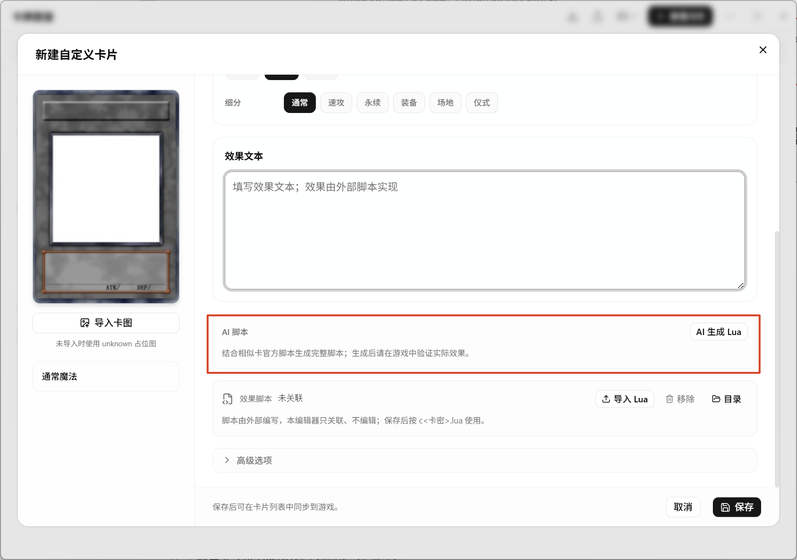

### 高级选项

- **同名卡（Alias）**：0 表示不设置；异画/复刻填原卡卡密，规则上视为同名卡。
- **字段**：4 个槽，十六进制 `0000~FFFF`；可以从现有字段名选择，也可以自定义名称。

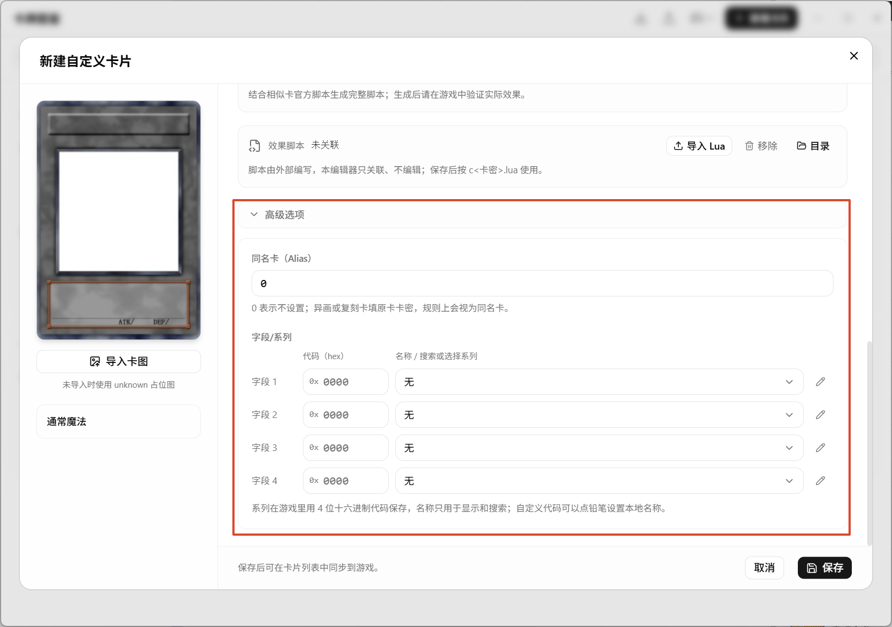

## 保存与卡图

- 点“保存”后：
  - 卡片数据写入 `custom_cards.json`；
  - 卡图写入 `custom/pics/<卡密>.<扩展名>`；
  - 脚本写入 `custom/script/c<卡密>.lua`；
  - 自定义卡库 `custom/yde-custom.cdb` 会重建。
- 卡图支持 jpg/jpeg/png/webp/gif；建议用标准卡图比例，避免拉伸。
- 没有导入卡图时显示 unknown 占位图。
- 保存失败会显示错误；成功但有卡图/脚本问题时会有警告。

## 删除自定义卡

- 会删除自定义卡数据、卡图和脚本；从图鉴里删除时还会清理它的召唤词/备注。
- 已经放在盘面上的卡不会自动消失，但会变成未知卡数据。
- 卡密不会回收。

## 同步到游戏

自定义卡默认只在软件里可见。要让客户端读到，需要同步。

同时会写入占位卡（99999999/99999998/99999997）和同步清单 `.yde-custom-sync.json`。下次同步会清理清单里已经不需要的旧文件。

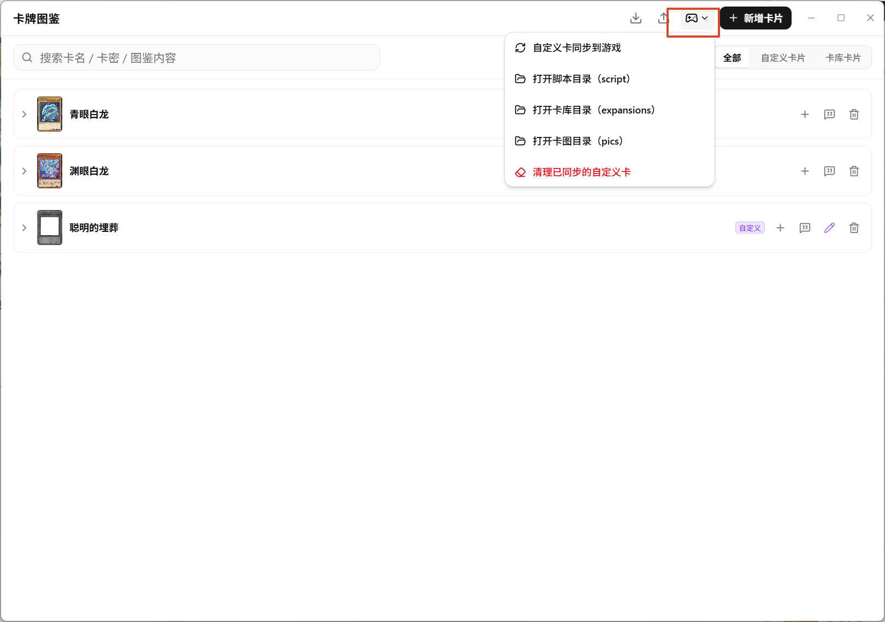

### 清理

“清理已同步的自定义卡”会删除本软件写入游戏目录的自定义卡库、脚本、卡图，不影响：

- 软件内的自定义卡数据；
- 你的工程；
- 游戏原有的卡库/脚本/卡图。

### 自动同步

“使用游戏测试该局”时，如果盘面里有占位卡/自定义卡，软件会提示

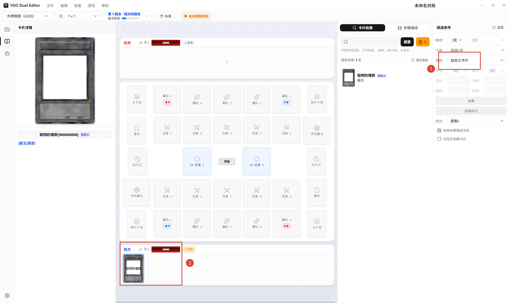

测试对局

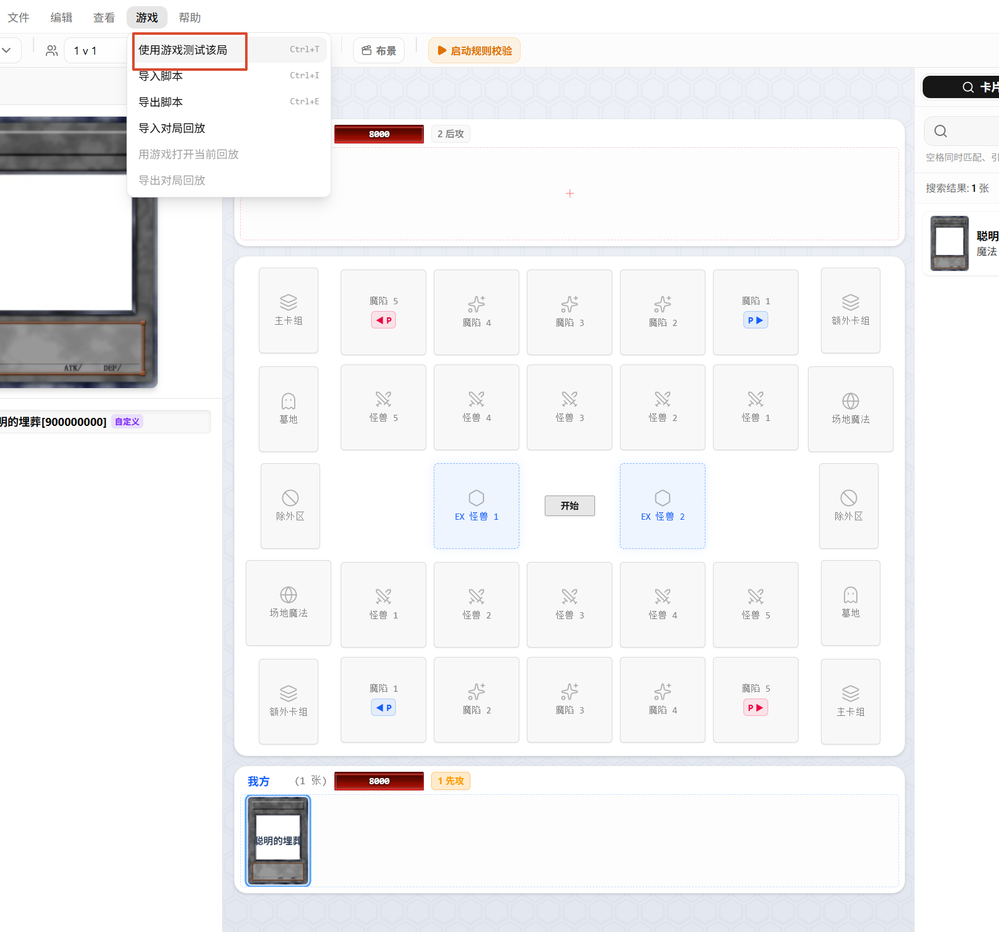

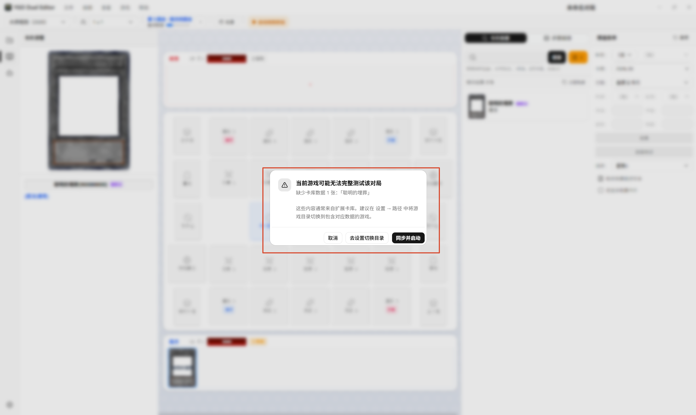
